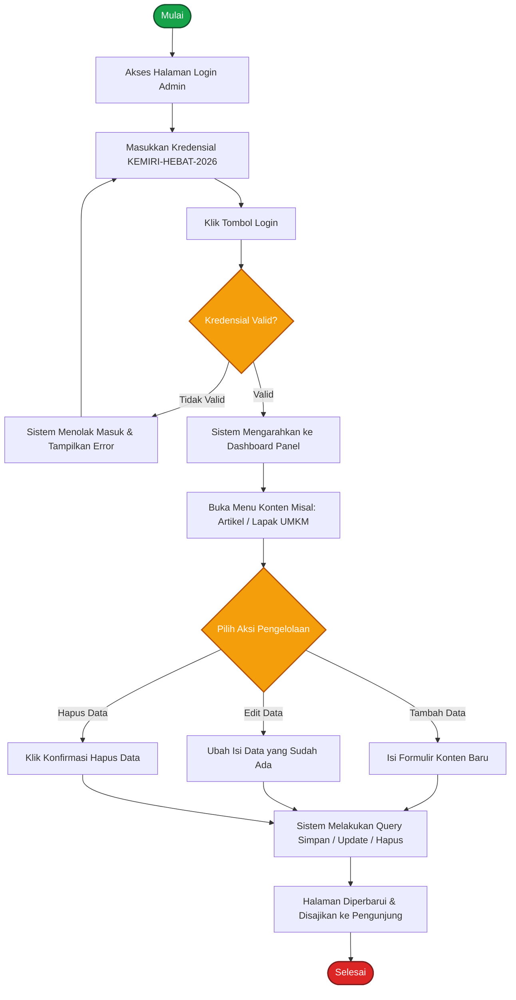
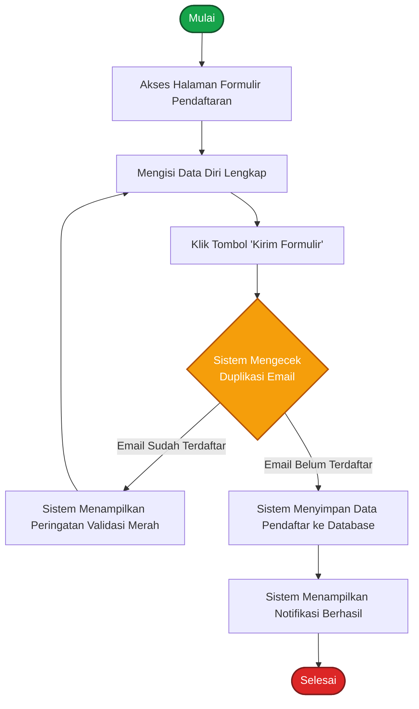
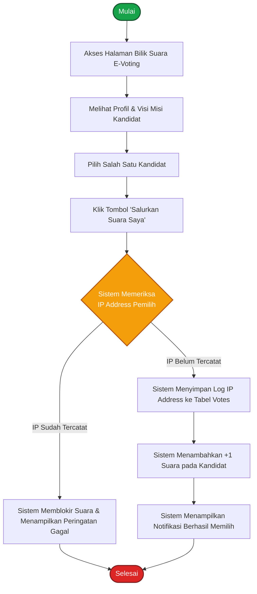
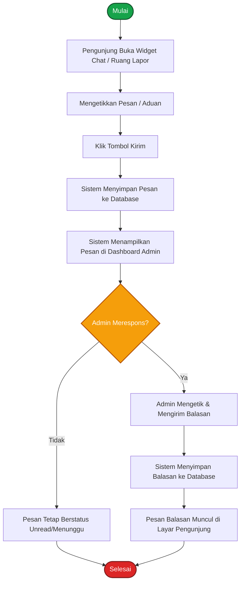
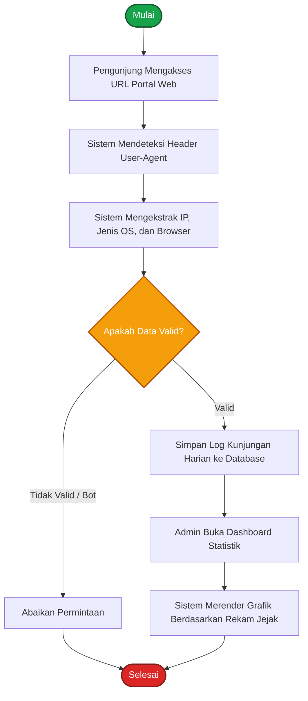
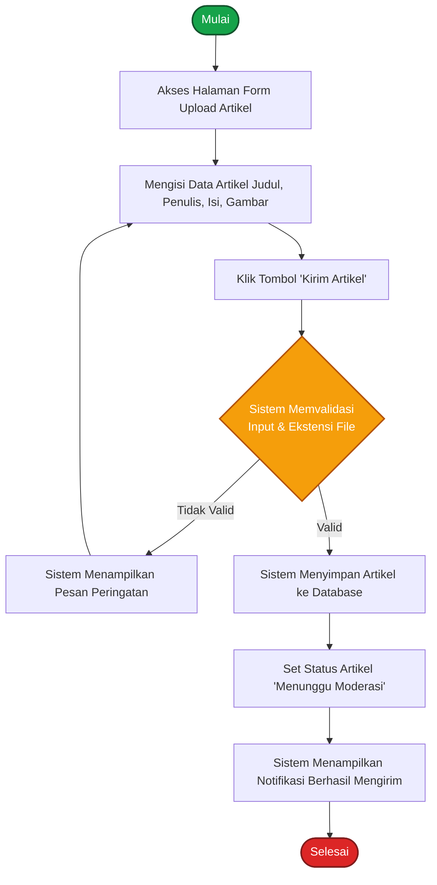

# ACTIVITY DIAGRAM

Activity Diagram menggambarkan alur kerja (*workflow*) sistem dari awal hingga akhir, termasuk proses pengambilan keputusan (*decision*) yang dilakukan oleh sistem di latar belakang.

Berdasarkan fungsionalitas inti proyek Portal Web dan E-Voting IPNU IPPNU Kemiri (sejalan dengan proses DFD Level 1), berikut adalah 5 (lima) *Activity Diagram* yang mewakili seluruh proses krusial dalam sistem:

---

## 1. Activity Diagram: Pengelolaan Konten Portal Web oleh Admin

Alur ini menggambarkan perjalanan Administrator dari pintu masuk sistem (*Login*) hingga proses mengubah isi portal web (misal: Artikel, Lapak UMKM, atau Struktur BPH).

**Penjelasan Alur:**
1. Admin wajib mematuhi sistem *Middleware Auth*. Apabila mencoba meretas dan sandi salah, sistem akan mendepaknya kembali ke halaman *login*.
2. Jika berhasil *login*, Admin masuk ke *dashboard* dan memilih menu konten yang akan dimanipulasi (*Create, Read, Update, Delete* / CRUD).
3. Setelah admin mengeksekusi operasi data, *database* diperbarui dan perubahan langsung terlihat di web publik.

---

## 2. Activity Diagram: Pendaftaran MAKESTA Online

Alur ini menggambarkan proses saat seorang Calon Anggota mengisi formulir, di mana sistem akan melakukan pengecekan (*validasi*) untuk memastikan tidak ada duplikasi email.

**Penjelasan Alur:**
1. Pengunjung masuk ke halaman formulir pendaftaran MAKESTA dan mengisi data.
2. Sistem mengecek tabel `registrations` di *database* SQLite.
3. Jika email sudah terdaftar, proses ditolak (*error message*). Jika email unik, sistem sukses menyimpan berkas pendaftaran calon kader baru.

---

## 3. Activity Diagram: Pelaksanaan Pemilihan E-Voting Terproteksi

Alur ini menggambarkan bagaimana bilik suara beroperasi dan bagaimana sistem memproteksi integritas suara menggunakan validasi alamat IP (*IP Address*).

**Penjelasan Alur:**
1. Pemilih (Voter) menyalurkan suaranya di bilik e-Voting digital.
2. *Backend* mendeteksi IP Address pemilih. Jika IP tersebut sudah ada di tabel `votes`, suara diblokir.
3. Jika IP belum ada, IP direkam dan jumlah suara kandidat bertambah secara otomatis.

---

## 4. Activity Diagram: Manajemen Chat & Ruang Lapor

Alur ini menggambarkan interaksi langsung antara pengunjung dan pengurus via fitur chatbot/live chat dan formulir laporan.

**Penjelasan Alur:**
1. Pengunjung web mengirimkan laporan atau obrolan chat.
2. Sistem menampung pesan dan memunculkan notifikasi di *dashboard backend* administrator.
3. Saat admin membalas, sistem kembali meneruskan pesan balasan tersebut langsung ke *widget* obrolan pengunjung.

---

## 5. Activity Diagram: Pelacakan Statistik Pengunjung

Alur latar belakang ini menggambarkan otomatisasi pencatatan rekam jejak OS (Sistem Operasi) dan web browser pengunjung tanpa perlu ada interaksi manual.

**Penjelasan Alur:**
1. Saat halaman dimuat, sistem *backend* mengekstrak string *User-Agent* milik pengunjung.
2. Sistem menyaring apakah itu *request* dari pengunjung asli, jika iya maka data dicatat.
3. Kumpulan *log* tersebut dirender menjadi grafik interaktif yang bisa dipantau secara visual oleh Administrator di halaman muka panel admin.

---

## 6. Activity Diagram: Upload Artikel oleh Pengunjung

Alur ini menggambarkan proses pengunjung web (non-admin) saat mengirimkan tulisan/artikel karya mereka ke redaksi portal, mulai dari pengisian form hingga statusnya masuk antrean moderasi.

**Penjelasan Alur:**
1. Pengunjung (Penulis) mengakses form kontribusi artikel dan mengisi kelengkapan data seperti judul, nama penulis, isi konten, dan melampirkan gambar.
2. Sistem *backend* memvalidasi form (memastikan tidak ada yang kosong dan gambar sesuai format). Jika tidak valid, pengunjung diminta memperbaiki isian.
3. Jika valid, artikel disimpan di *database* dengan status *Pending* (Menunggu Moderasi). Artikel tidak langsung tayang di portal web.
4. Pengunjung menerima notifikasi sukses bahwa artikel telah dikirim dan sedang menunggu tinjauan dari Administrator/Redaksi.
