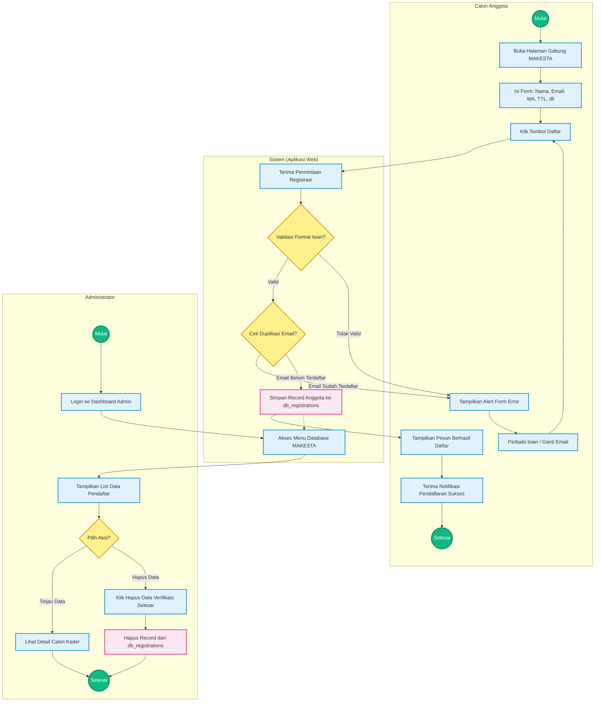

# Activity Diagram - Pendaftaran & Kelola Anggota (MAKESTA)

Activity Diagram ini memvisualisasikan alur sistem dalam menangani proses registrasi anggota baru (MAKESTA) hingga proses pengelolaan data pendaftar oleh administrator. Alur kerja dibagi ke dalam tiga pihak (*swimlane*), yaitu **Calon Anggota** (pihak yang mendaftar), **Sistem** (yang bertugas memvalidasi email unik dan menyimpan data), dan **Administrator** (yang mengawasi dan mengelola data registrasi di *dashboard*).

## Diagram

## Penjelasan Alur (Workflow):

1. **Calon Anggota**:
   - Proses dimulai saat pengguna (calon kader) membuka halaman **Gabung MAKESTA**.
   - Pengguna diwajibkan melengkapi kolom formulir (seperti Nama Lengkap, Email unik, No WA, Tempat/Tanggal Lahir, Pendidikan, Rencana Tanggal MAKESTA, dan Alamat Rumah).
   - Setelah formulir terisi, pengguna mengirim data dengan mengeklik tombol Daftar.

2. **Sistem (Aplikasi Web)**:
   - Sistem menerima kiriman formulir dan melakukan validasi bertahap:
     1. **Validasi Format**: Mengecek apakah ada field wajib yang kosong atau format yang salah.
     2. **Validasi Keunikan (Duplikasi Email)**: Mengecek tabel basis data `registrations` (`db_registrations`). Apabila *email* yang dimasukkan sudah pernah terdaftar, sistem menolak proses dan memberikan peringatan "*Email ini sudah terdaftar sebelumnya*".
   - Apabila kedua validasi di atas lolos, maka sistem menyetujui pendaftaran dan mengunci data pendaftar baru ke dalam database secara permanen.
   - Pendaftar menerima layar notifikasi registrasi berhasil.

3. **Administrator (Kelola Anggota)**:
   - Admin (*secretariat*) yang bertugas, login secara aman ke dashboard backend.
   - Admin membuka panel menu Database MAKESTA yang terintegrasi secara *real-time* menampilkan daftar lengkap pendaftar terbaru.
   - **Tinjau Data**: Admin dapat melihat detail isian formulir kader.
   - **Hapus Data (Opsional)**: Setelah data diverifikasi, direkapitulasi secara manual/fisik, atau diekspor, admin dapat melakukan aksi Hapus untuk membuang *record* dari database jika dirasa perlu untuk mengosongkan beban data server.
