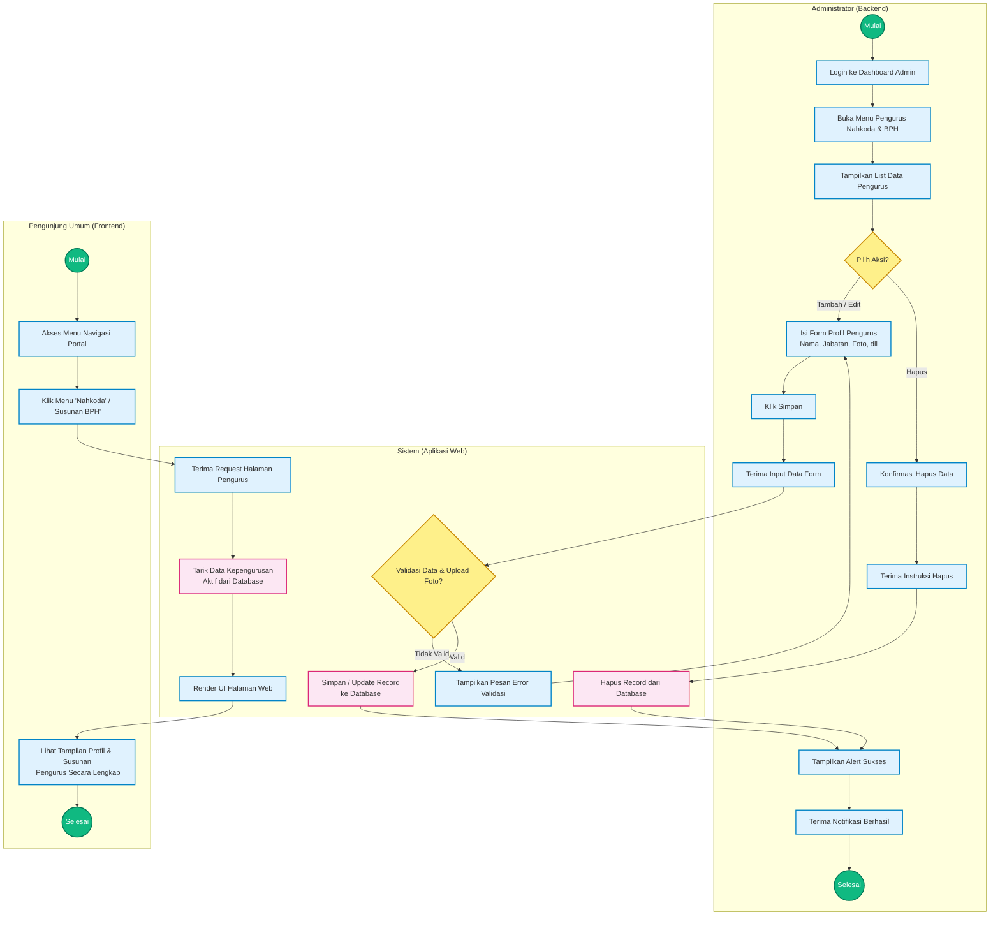

# Activity Diagram - Kelola Profil Kepengurusan (Nahkoda & BPH)

Activity Diagram ini menggambarkan alur kerja pengelolaan data profil kepengurusan organisasi (seperti Pimpinan Nahkoda dan Badan Pengurus Harian/BPH). Proses ini melibatkan **Administrator** yang mengelola pembaruan data secara dinamis (*Create, Read, Update, Delete*), **Sistem** yang memvalidasi dan menyimpan data ke *database*, serta **Pengunjung** umum yang mengakses dan melihat susunan pengurus tersebut di halaman depan (portal web).

## Diagram

## Penjelasan Alur (Workflow):

1. **Administrator (Backend)**:
   - Admin bertugas memperbarui profil pengurus secara dinamis menyesuaikan periode masa khidmat.
   - Admin login dan masuk ke menu khusus manajemen pengurus (Nahkoda & BPH).
   - Di sini, admin dapat melakukan 3 jenis manipulasi data:
     1. **Tambah / Edit Profil**: Admin memasukkan atau merevisi informasi pengurus (seperti Nama, Jabatan fungsional, dan mengunggah Foto Resmi), lalu menyimpannya.
     2. **Hapus Data**: Apabila terdapat pergantian/reshuffle, admin bisa menghapus data pengurus yang lama.

2. **Sistem (Aplikasi Web)**:
   - **Manajemen Form**: Saat admin melakukan Tambah/Edit, sistem memvalidasi teks dan memastikan file foto yang diunggah sesuai ukuran dan format yang benar. Jika lolos, record disimpan/diperbarui ke dalam database.
   - **Manajemen Visual**: Jika pengunjung meminta akses halaman profil pengurus, sistem akan menarik keseluruhan struktur data pengurus dari database lalu memuatnya (render) ke dalam bentuk halaman berdesain visual modern (*glassmorphism*) yang bisa dibaca pengunjung.

3. **Pengunjung Umum (Frontend)**:
   - Pengunjung umum tidak memiliki hak akses mengubah profil. Mereka hanya masuk ke portal web dan memilih menu navigasi seperti "Nahkoda" atau "Susunan BPH".
   - Selanjutnya, mereka langsung dapat melihat profil pimpinan serta jajaran pengurus harian yang paling aktual dan ter-update berdasarkan input terbaru dari admin.
