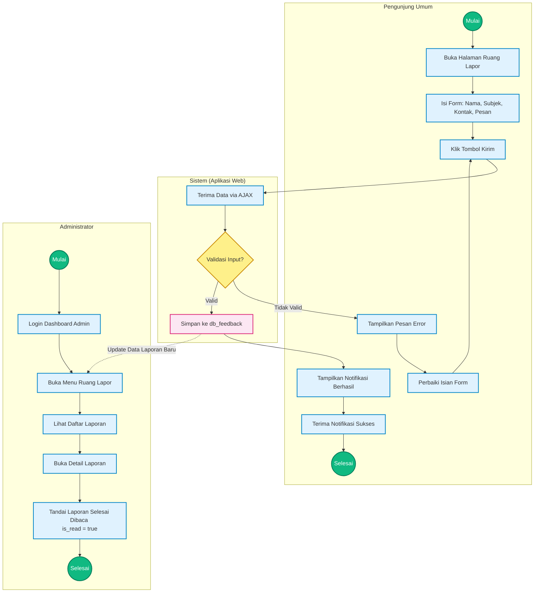

# Activity Diagram - Pelaporan (Ruang Lapor)

Activity Diagram ini menggambarkan alur kerja fungsional dari fitur **Ruang Lapor** pada sistem informasi portal web PAC IPNU IPPNU Kemiri. Diagram ini membagi proses ke dalam tiga *swimlane* yang merepresentasikan interaksi antara **Pengunjung** (pengguna umum yang mengirimkan kritik/saran), **Sistem** (proses validasi dan penyimpanan), serta **Admin** (pihak yang memantau dan merespon laporan).

## Diagram

## Penjelasan Alur (Workflow):

1. **Pengunjung Umum**:
   - Pengunjung mengakses menu Ruang Lapor di portal web.
   - Pengunjung mengisi formulir pengaduan (Nama, Subjek, Kontak, dan Pesan).
   - Pengunjung mengklik tombol Kirim (proses dilakukan secara asinkron menggunakan AJAX).

2. **Sistem (Aplikasi Web)**:
   - Sistem menerima kiriman data form dan melakukan **validasi** (memastikan field wajib telah diisi dengan format yang benar).
   - Jika **Tidak Valid**: Sistem menampilkan pesan peringatan/error. Pengunjung kemudian harus memperbaiki isiannya.
   - Jika **Valid**: Sistem menyimpan data laporan ke dalam tabel basis data `feedbacks` (`db_feedback`).
   - Setelah sukses menyimpan, sistem mengembalikan notifikasi keberhasilan kepada pengunjung.

3. **Administrator**:
   - Admin melakukan login dan masuk ke Dashboard.
   - Admin membuka menu pengaduan/laporan (Ruang Lapor) dan melihat daftar laporan terbaru yang baru saja diinput oleh pengunjung.
   - Admin memilih dan membaca rincian laporan tersebut.
   - Setelah selesai ditinjau, admin dapat menandai laporan sebagai sudah dibaca (`is_read = true`), menyelesaikan siklus pelaporan di sistem.
