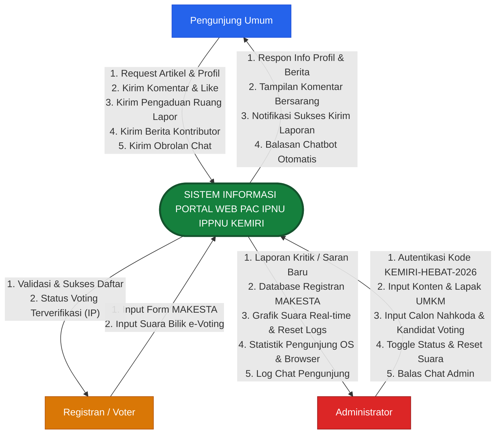
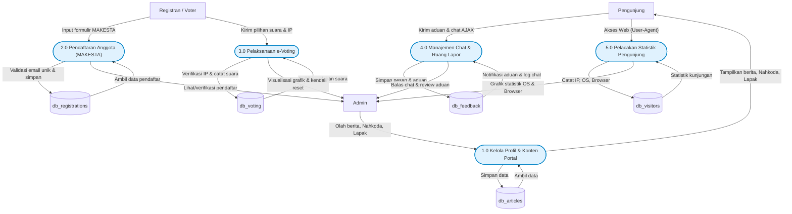
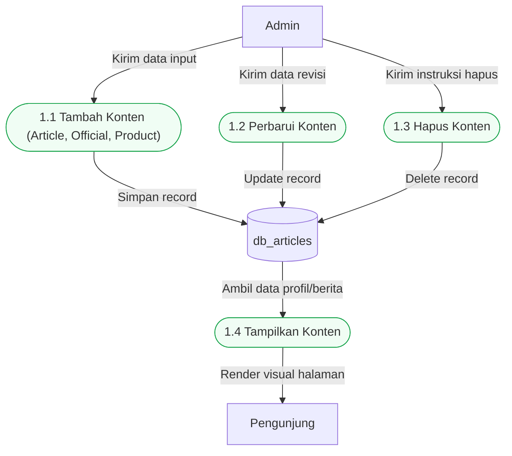
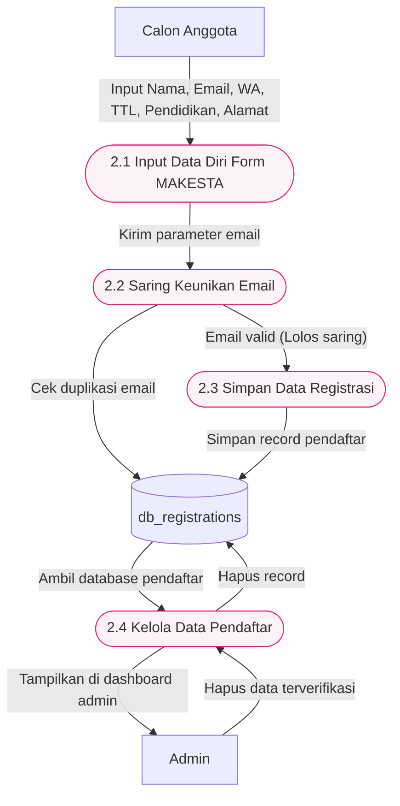
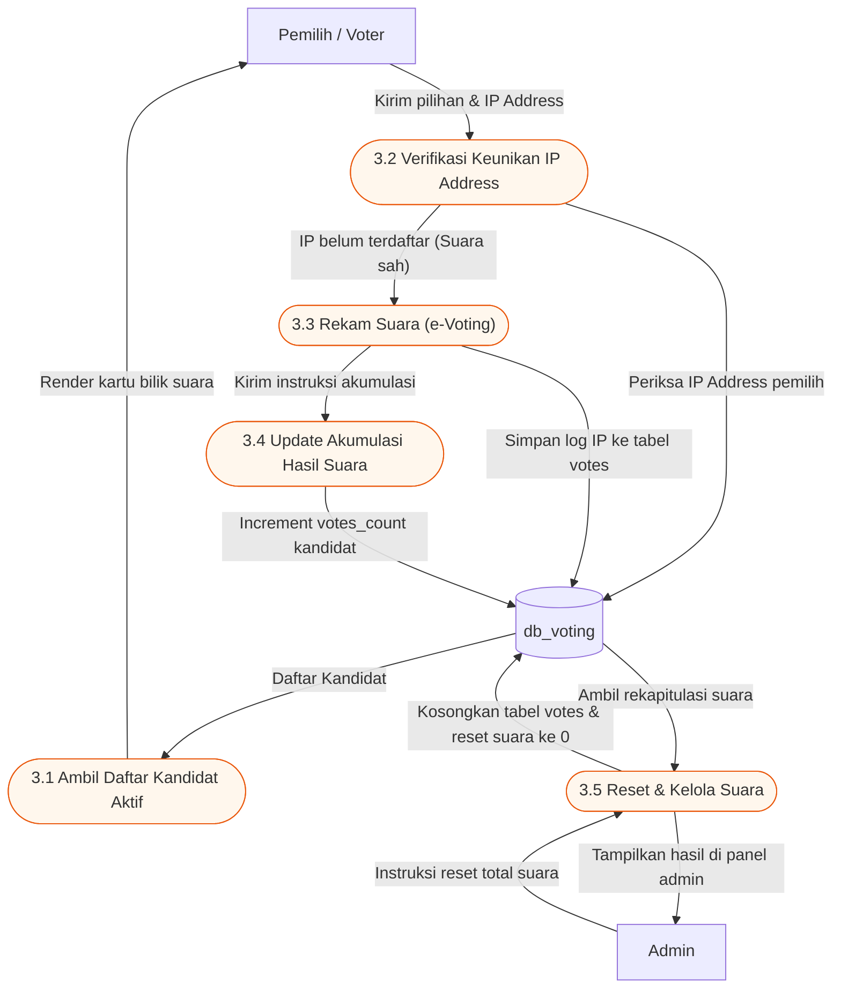
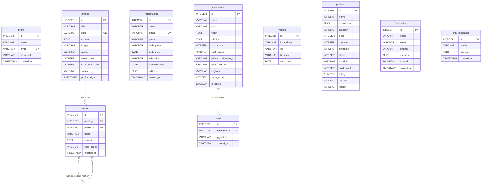
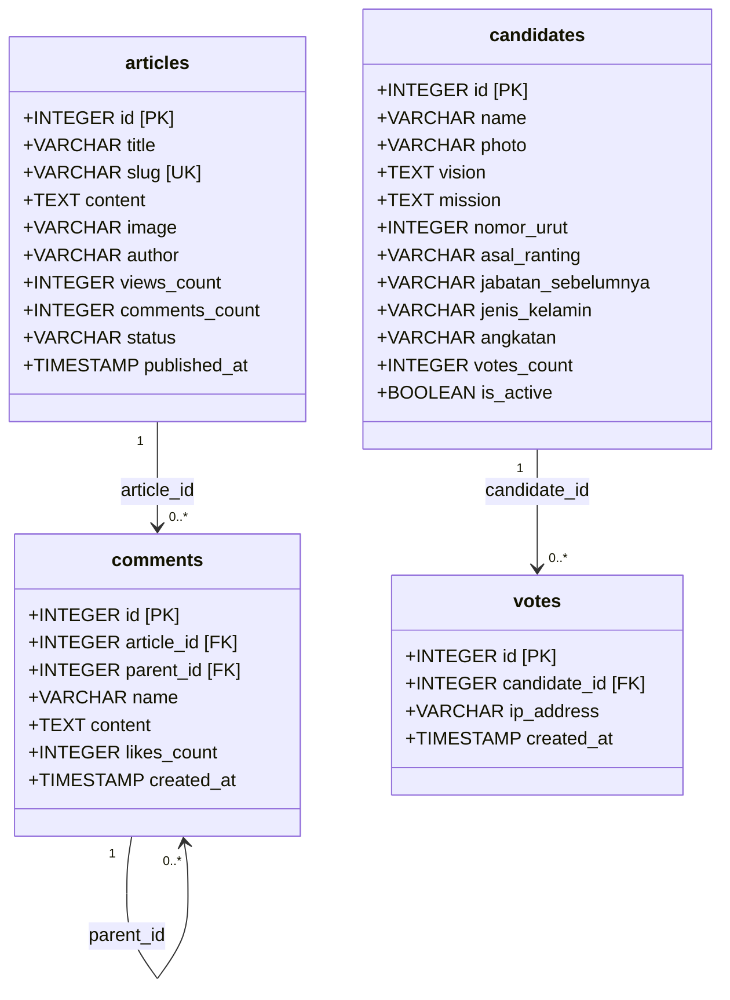

# BAB IV: HASIL DAN PEMBAHASAN

## A. Pengumpulan Data
Untuk memperoleh landasan perancangan sistem informasi portal web dan e-voting yang akurat serta relevan dengan kondisi operasional di lapangan, penulis mengawali Kerja Praktik dengan melakukan pengumpulan data primer melalui dua metode pendekatan ilmiah, yakni observasi sistematis dan wawancara terstruktur.

### 1. Metode Observasi (Observation)
Penulis melakukan pengamatan langsung terhadap ekosistem administrasi, penyebaran informasi, dan proses pemilihan kepengurusan pada sekretariat PAC IPNU IPPNU Kecamatan Kemiri. Hasil pengamatan empiris tersebut dipetakan ke dalam tabel di bawah ini:

<b>Tabel 4.1 Objek dan Hasil Observasi Lapangan</b>

| No | Objek yang Diamati | Proses/Kondisi Saat Ini | Temuan Kendala / Kelemahan | Dampak Terhadap Organisasi |
|---|---|---|---|---|
| 1 | **Sistem Rekrutmen & Pendataan Anggota (MAKESTA)** | Calon anggota mengisi formulir kertas atau Google Form terpisah pada setiap Ranting (Desa). | Data kader tersimpan secara tersebar, rawan hilang, dan sistem tidak memvalidasi keunikan email pendaftar di backend. | Sekretaris kesulitan melacak jumlah kader alumni MAKESTA aktual dan sering terjadi redundansi data. |
| 2 | **Publikasi Profil & Agenda Kegiatan** | Penyebaran informasi sejarah, visi-misi, dan program kerja hanya mengandalkan grup WhatsApp dan Instagram. | Linimasa postingan media sosial cepat tertumpuk oleh konten baru sehingga data arsip lama sulit diakses secara cepat. | Anggota baru dan masyarakat umum kesulitan mencari profil kepengurusan Nahkoda & BPH secara lengkap. |
| 3 | **Pelaksanaan e-Voting Pemilihan Ketua** | Pemungutan suara pemilihan ketua PAC dilakukan secara konvensional menggunakan bilik fisik dan kertas suara. | Panitia harus mencetak ratusan lembar kertas suara, memakan waktu rekapitulasi 3-4 jam, dan rawan kecurangan pemilih ganda. | Pengeluaran biaya cetak logistik tinggi dan sidang pleno pemilihan berjalan lambat serta tidak efisien. |
| 4 | **Pemberdayaan Ekonomi Kreatif** | Anggota memiliki berbagai unit usaha UMKM mandiri (katalog produk fisik) namun dipromosikan secara lisan. | Ketiadaan wadah katalog digital khusus yang dapat diakses publik untuk menampung promosi produk kader. | Kemandirian ekonomi organisasi kurang terpacu dan pasar produk UMKM kader hanya terbatas di lingkup kecil. |

---

### 2. Metode Wawancara (Interview)
Wawancara terstruktur diselenggarakan bersama jajaran pengurus harian inti PAC IPNU IPPNU Kecamatan Kemiri guna menggali ekspektasi fungsional sistem informasi baru. Rangkuman hasil tanya-jawab tersebut disajikan pada tabel berikut:

<b>Tabel 4.2 Daftar Pertanyaan dan Jawaban Sesi Wawancara</b>

| No | Informan / Jabatan | Pertanyaan Wawancara | Jawaban Informan | Kebutuhan Fitur Teridentifikasi |
|---|---|---|---|---|
| 1 | **Rekan Ahmad Fauzi** (Ketua PAC IPNU Kemiri) | *"Bagaimana proses pemilihan ketua PAC yang selama ini berjalan dan apa ekspektasi Anda terhadap sistem pemilihan digital?"* | *"Pemilihan ketua masih manual menggunakan kertas suara. Rekapitulasi suara memakan waktu berjam-jam. Kami membutuhkan sistem e-voting mandiri yang aman, transparan, cepat, dan memiliki proteksi ketat agar pemilih tidak bisa memanipulasi suara atau memilih lebih dari satu kali."* | Bilik suara digital e-voting dengan sistem verifikasi dan proteksi keunikan IP Address pemilih di backend Laravel. |
| 2 | **Rekanita Wiji Masruroh** (Ketua PAC IPPNU Kemiri) | *"Apa kendala terbesar dalam publikasi profil kepengurusan Nahkoda dan agenda kerja terdekat kepada khalayak umum?"* | *"Kader baru dan masyarakat luar sering kesulitan mencari profil kepengurusan resmi, sejarah, dan visi-misi PAC Kemiri karena di media sosial postingannya sering tenggelam. Kami butuh portal informasi satu pintu yang profesional, memiliki visual hijau-emas khas NU yang moderen, serta dilengkapi chatbot otomatis."* | Portal web portal informasi satu pintu dengan gaya desain Glassmorphism responsif, menu picker tema dinamis, dan widget chatbot AJAX. |
| 3 | **Rekanita Erliana Ayu Solichah** (Sekretaris PAC IPPNU Kemiri) | *"Bagaimana sistem pendataan pendaftaran kader MAKESTA online yang ideal menurut kesekretariatan?"* | *"Kami sangat membutuhkan formulir pendaftaran digital terpusat. Namun, yang paling krusial adalah sistem harus mampu menolak secara otomatis apabila ada pendaftar yang memasukkan email yang sudah pernah terdaftar, agar database alumni MAKESTA kami tetap rapi dan valid."* | Formulir registrasi Gabung MAKESTA online yang dilengkapi validasi backend `unique:registrations,email` untuk mencegah redundansi data. |

---

## B. Analisis Kebutuhan Sistem
Berdasarkan temuan data observasi dan wawancara di atas, dirumuskan spesifikasi analisis kebutuhan sistem informasi baru guna memecahkan masalah operasional organisasi.

### 1. Kebutuhan Fungsional (Functional Requirements)
* **Pengunjung Umum**:
  1. Mengakses menu sejarah, visi-misi PAC, profil pengurus BPH & pimpinan Nahkoda secara dinamis.
  2. Membaca artikel berita, melakukan pencarian artikel, memberikan komentar bersarang (*nested replies*), dan menyukai komentar (*like*).
  3. Mengirimkan karya tulis kontributor (artikel publik) dengan status *pending* untuk dimoderasi admin.
  4. Mengisi formulir Ruang Lapor untuk mengirim kritik/saran ke dashboard admin secara asinkron.
  5. Mengakses katalog Lapak UMKM Kader (produk, harga, diskon, stok, lokasi, dan link pesanan WhatsApp).
  6. Mengisi formulir registrasi online untuk mengikuti kegiatan kaderisasi MAKESTA.
  7. Berinteraksi dengan chatbot interaktif di halaman beranda.
  8. Memberikan suara pemilihan ketua di halaman e-voting.
* **Administrator**:
  1. Melakukan registrasi admin dengan kode khusus **`KEMIRI-HEBAT-2026`** dan melakukan login/logout aman.
  2. Mengelola artikel berita (termasuk memoderasi/menyetujui artikel publik yang masuk).
  3. Mengelola data Nahkoda/Pengurus BPH, program kerja, agenda kegiatan, galeri foto, dan site settings.
  4. Mengelola katalog produk lapak UMKM kader dan banner promosi iklan (*advertisement*).
  5. Mengelola e-voting (mengatur nomor urut kandidat, visi-misi, foto resmi, toggle status keaktifan kandidat, memantau grafik perolehan suara secara real-time, serta tombol pengaman reset perolehan suara parsial/total).
  6. Membalas chat pengunjung yang masuk secara interaktif di panel admin chat room.
  7. Memantau database pendaftar baru MAKESTA dan laporan Ruang Lapor.

### 2. Kebutuhan Non-Fungsional (Non-Functional Requirements)
* **Keamanan (Security)**: Sandi admin dienkripsi wajib menggunakan Bcrypt 12 rounds, proteksi rute admin menggunakan Middleware Auth Laravel, proteksi CSRF pada formulir input.
* **Kompatibilitas & Portabilitas**: Antarmuka responsif adaptif di berbagai web browser modern (Google Chrome, Firefox, Safari, Edge) dan kompatibel penuh pada layar HP maupun desktop dengan pendeteksian otomatis tipe OS (Windows, MacOS, Linux, Android, iOS).
* **Kinerja & Ringan**: Kompilasi asset super cepat berbasis bundler Vite 7.0 dan Tailwind CSS 4.0.0, pemrosesan query database SQLite 3 yang sangat ringan tanpa memerlukan server eksternal database yang berat.

---

## C. Pembahasan dan Perancangan Sistem Rinci
Bagian ini menyajikan rancangan arsitektur pemodelan sistem fungsional, perancangan basis data, kamus data teknis, hingga panduan implementasi antarmuka (*mockup*) sistem PAC IPNU IPPNU Kemiri yang telah dipublikasikan secara resmi di alamat:
🔗 **[https://ipnukemiri.jaidiperform.my.id/](https://ipnukemiri.jaidiperform.my.id/)**

### 1. Perancangan Diagram Konteks (Context Diagram)
Diagram Konteks di bawah memetakan batasan sistem global serta aliran pertukaran data keluar-masuk antara sistem informasi portal web dengan 3 aktor luar utama:

<b>Gambar 4.1 Diagram Konteks Fungsional Sistem</b>

#### Penjelasan Aliran Data Diagram Konteks:
* **Pengunjung Umum**: Mengajukan *request* berita dan profil organisasi ➡️ sistem menyajikan halaman web dinamis. Pengunjung mengirimkan data komentar/like, pengaduan Ruang Lapor, naskah artikel, dan pesan chat AJAX ➡️ sistem merespon dengan menyajikan komentar bersarang, notifikasi sukses kirim aduan, dan balasan chat.
* **Calon Anggota & Voter**: Mengirimkan data formulir MAKESTA dan suara pemilu ketua ➡️ sistem melakukan validasi email unik di database, memvalidasi hak suara dengan mengecek IP Address pemilih, lalu menampilkan notifikasi sukses daftar dan suara sah masuk.
* **Administrator**: Mengirimkan masukan berupa kode rahasia registrasi (`KEMIRI-HEBAT-2026`), input artikel, profil Nahkoda, katalog lapak UMKM, setelan web, kandidat pemilihan ketua, toggle status bilik, instruksi reset suara, dan balasan chat manual ➡️ sistem memberikan output berupa data pengaduan unread, database registran MAKESTA, log perolehan e-voting, log chat masuk, dan visualisasi grafik visitor tracker (OS & Browser).

---

### 2. Perancangan Data Flow Diagram (DFD) Lengkap
Penulis membagi perancangan aliran data terstruktur sistem menjadi DFD Level 0 dan DFD Level 1 terperinci.

#### a. Data Flow Diagram (DFD) Level 0
DFD Level 0 menguraikan sistem tunggal menjadi 5 sub-proses transaksional utama yang berinteraksi secara dinamis dengan penyimpanan basis data (*Data Store* SQLite).

<b>Gambar 4.2 DFD Level 0 Rancangan Sistem</b>

#### b. DFD Level 1 Proses 1.0 (Kelola Profil & Konten Portal)
Menjelaskan aliran detail pengelolaan artikel, susunan Nahkoda pengurus, dan katalog produk UMKM lapak kader:

<b>Gambar 4.3 DFD Level 1 Proses 1.0 (Konten)</b>

* **Penjelasan Aliran**: Admin menyusun data berita atau produk UMKM ➡️ proses 1.1 menyimpan record baru ke data store `db_articles` (berisi tabel `articles`, `officials`, `products`, `agendas`, `programs`, `galleries`). Admin melakukan pembetulan data ➡️ proses 1.2 memperbarui record di database. Admin menghapus konten ➡️ proses 1.3 menghapus record dari basis data. Database mengirimkan data artikel/profil yang valid ke proses 1.4 untuk dirender dan ditampilkan secara dinamis di peramban Pengunjung.

#### c. DFD Level 1 Proses 2.0 (Pendaftaran Anggota MAKESTA Online)
Mendetailkan proses input data diri calon kader baru hingga tersimpan aman bebas dari duplikasi data email:

<b>Gambar 4.4 DFD Level 1 Proses 2.0 (MAKESTA)</b>

* **Penjelasan Aliran**: Calon anggota baru melengkapi form pendaftaran online ➡️ proses 2.1 mengirim data pendaftar ke penyaringan keunikan email 2.2. Proses 2.2 melakukan pengecekan data email di `db_registrations`. Jika email belum terdaftar (lolos saring) ➡️ proses 2.3 menyimpan data pendaftaran kader baru secara permanen. Admin mengakses database pendaftaran melalui proses 2.4 untuk memantau pendaftar MAKESTA baru, serta mengirimkan perintah hapus untuk membuang record dari database setelah verifikasi selesai dilakukan.

#### d. DFD Level 1 Proses 3.0 (Pelaksanaan e-Voting Terproteksi IP)
Menerangkan alur bilik suara e-voting pemilu ketua PAC yang diamankan oleh sistem validasi alamat IP perangkat backend:

<b>Gambar 4.5 DFD Level 1 Proses 3.0 (e-Voting)</b>

* **Penjelasan Aliran**: Halaman bilik suara mengambil data kandidat aktif dari database `db_voting` melalui proses 3.1 untuk disajikan kepada Voter. Ketika Voter memberikan suaranya, proses 3.2 mengambil IP Address pemilih dan mencocokkannya ke database. Jika IP belum terdaftar (suara sah) ➡️ proses 3.3 menyimpan record IP pemilih ke tabel log `votes`, kemudian memicu proses 3.4 untuk melakukan *increment* (+1) nilai perolehan `votes_count` kandidat terpilih pada tabel `candidates`. Admin mengakses proses 3.5 untuk memantau perolehan suara grafik, serta dapat mengirim perintah reset total untuk mengosongkan log IP pemilih secara aman.

---

### 3. Entity Relationship Diagram (ERD)
ERD memodelkan relasi konseptual antarentitas di dalam database SQLite PAC IPNU IPPNU Kemiri:

<b>Gambar 4.6 Entity Relationship Diagram (ERD) Relasional</b>

#### Penjelasan Detil Entitas ERD:
* **`users`**: Menyimpan kredensial otentikasi login administrator.
* **`articles` & `comments`**: Menyimpan data berita kegiatan organisasi serta komentar bersarang (*nested comments*) dari pembaca.
* **`registrations`**: Menyimpan data formulir pendaftaran daring calon anggota baru MAKESTA.
* **`candidates` & `votes`**: Menyimpan profil lengkap calon ketua PAC, status keaktifan bilik suara, total akumulasi perolehan suara, serta log unik IP Address pemilih.
* **`visitors`**: Menyimpan log harian parameter IP Address, tipe sistem operasi, dan browser pengunjung portal.
* **`products`**: Menyimpan katalog lengkap produk Lapak Usaha UMKM milik kader.
* **`feedbacks` & `chat_messages`**: Menampung kiriman saran/kritik Ruang Lapor serta log obrolan chatbot.

---

### 4. Diagram Relasi Antartabel Fisik (Table Relationship Diagram)
Diagram relasi fisik memodelkan keterkaitan skema tabel fisik, tipe data, serta *primary key* (PK) dan *foreign key* (FK) yang secara nyata terbentuk di database SQLite, sebagaimana divisualisasikan secara lengkap pada **Gambar 4.7** berikut ini:

<b>Gambar 4.7 Diagram Relasi Antartabel Fisik</b>

#### Penjelasan Relasi Fisik Basis Data berdasarkan Gambar 4.7:
Merujuk pada **Gambar 4.7** di atas, arsitektur basis data sistem ini mengimplementasikan relasi antar entitas sebagai berikut:
1. **Relasi Fisik `articles` ➡️ `comments` (Kardinalitas 1 : Banyak)**:
   Kolom kunci utama `id` pada tabel `articles` berelasi fisik dengan kolom kunci tamu `article_id` pada tabel `comments`. Setiap baris komentar wajib merujuk ke satu ID artikel yang sah. Relasi didefinisikan dengan *constraint* `ON DELETE CASCADE`, sehingga apabila baris artikel dihapus dari database, semua baris komentar yang merujuk pada artikel tersebut akan terhapus otomatis demi menjaga integritas data.
2. **Relasi Fisik Bersarang `comments` ➡️ `comments` (Kardinalitas 1 : Banyak)**:
   Tabel `comments` memiliki relasi rekursif (*self-referencing*) menggunakan kolom kunci tamu `parent_id` yang merujuk kembali ke kolom kunci utama `id` pada tabel yang sama. Relasi ini memetakan hubungan hierarki percakapan: balasan komentar bertindak sebagai anak (*child record*) dari komentar induk (*parent record*). Jika komentar induk dihapus, balasan di bawahnya akan ikut terhapus.
3. **Relasi Fisik `candidates` ➡️ `votes` (Kardinalitas 1 : Banyak)**:
   Kolom kunci utama `id` pada tabel `candidates` berelasi fisik dengan kolom kunci tamu `candidate_id` pada tabel `votes`. Setiap suara masuk dalam bilik e-voting wajib merepresentasikan ID kandidat yang valid di tabel candidates.

---

### 5. Kamus Data Rinci (Data Dictionary)
Kamus data menjabarkan detail batasan atribut teknis, tipe data, sifat kolom, serta fungsi field pada tabel-tabel utama basis data SQLite.

#### a. Kamus Data Tabel `candidates` (Kandidat Pemilihan Ketua PAC)
* **Nama Tabel**: `candidates`
* **Fungsi**: Menyimpan data profil lengkap kandidat pemilihan ketua.

| Nama Kolom | Tipe Data | Panjang | Keterangan | Fungsi Atribut |
| :--- | :---: | :---: | :---: | :--- |
| `id` | INTEGER | - | PK, Auto Inc | ID unik penomoran otomatis kandidat. |
| `name` | VARCHAR | 255 | NOT NULL | Nama lengkap calon pimpinan. |
| `photo` | VARCHAR | 255 | Nullable | Path penyimpanan berkas foto resmi calon. |
| `vision` | TEXT | - | Nullable | Visi calon ketua PAC. |
| `mission` | TEXT | - | Nullable | Misi calon ketua PAC. |
| `nomor_urut` | INTEGER | - | Nullable | Nomor urut calon di bilik suara. |
| `asal_ranting` | VARCHAR | 255 | Nullable | Nama ranting asal kader (keterwakilan daerah). |
| `jabatan_sebelumnya`| VARCHAR| 255 | Nullable | Riwayat jabatan pengurus calon. |
| `jenis_kelamin` | VARCHAR | 1 | Nullable | Jenis kelamin kandidat (`L` / `P`). |
| `angkatan` | VARCHAR | 50 | Nullable | Tahun angkatan kaderisasi. |
| `votes_count` | INTEGER | - | Default: 0 | Jumlah akumulasi total suara sah. |
| `is_active` | BOOLEAN | - | Default: 1 | Mengaktifkan/menonaktifkan kandidat di bilik. |

#### b. Kamus Data Tabel `products` (Katalog Lapak Usaha UMKM Kader)
* **Nama Tabel**: `products`
* **Fungsi**: Menyimpan katalog produk pemberdayaan ekonomi milik kader.

| Nama Kolom | Tipe Data | Panjang | Keterangan | Fungsi Atribut |
| :--- | :---: | :---: | :---: | :--- |
| `id` | INTEGER | - | PK, Auto Inc | ID unik produk lapak. |
| `name` | VARCHAR | 255 | NOT NULL | Nama produk dagangan kader. |
| `description`| TEXT | - | Nullable | Spesifikasi detail produk. |
| `category` | VARCHAR | 100 | Default: 'Lainnya'| Kategori produk (Merchandise, Jasa, Kuliner). |
| `price` | INTEGER | - | NOT NULL | Harga jual produk dalam Rupiah. |
| `discount` | INTEGER | - | Default: 0 | Persentase diskon produk ($0\% - 99\%$). |
| `condition` | VARCHAR | 50 | Default: 'Baru' | Kondisi fisik barang (`Baru` / `Bekas`). |
| `stock` | INTEGER | - | Default: 0 | Ketersediaan jumlah produk. |
| `location` | VARCHAR | 255 | Default: 'Kemiri' | Lokasi pengambilan/toko. |
| `sold_count` | INTEGER | - | Default: 0 | Jumlah kumulatif produk terjual. |
| `rating` | NUMERIC | 3,1 | Default: 5.0 | Penilaian kepuasan pembeli ($1.0 - 5.0$). |
| `wa_link` | VARCHAR | 255 | Nullable | Tautan nomor WA terintegrasi pesanan langsung. |
| `image` | VARCHAR | 255 | Nullable | Path gambar produk dagangan. |

#### c. Kamus Data Tabel `registrations` (Pendaftar Anggota Baru MAKESTA)
* **Nama Tabel**: `registrations`
* **Fungsi**: Menyimpan berkas pendaftaran online calon anggota baru (kaderisasi).

| Nama Kolom | Tipe Data | Panjang | Keterangan | Fungsi Atribut |
| :--- | :---: | :---: | :---: | :--- |
| `id` | INTEGER | - | PK, Auto Inc | ID unik pendaftaran otomatis. |
| `name` | VARCHAR | 255 | NOT NULL | Nama lengkap pendaftar. |
| `email` | VARCHAR | 255 | UNIQUE, NOT NULL | Alamat email aktif calon kader. |
| `phone` | VARCHAR | 20 | Nullable | Nomor WhatsApp aktif. |
| `birth_place`| VARCHAR | 100 | Nullable | Kota tempat kelahiran pendaftar. |
| `birth_date` | DATE | - | Nullable | Tanggal lahir pendaftar. |
| `education` | VARCHAR | 100 | Nullable | Pendidikan terakhir pendaftar. |
| `makesta_date`| DATE | - | Nullable | Rencana tanggal mengikuti pelatihan MAKESTA.|
| `address` | TEXT | - | Nullable | Alamat rumah domisili lengkap. |
| `created_at` | TIMESTAMP | - | - | Tanggal rekam masuk pendaftaran. |

#### d. Kamus Data Tabel `visitors` (Statistik Tracker Pengunjung)
* **Nama Tabel**: `visitors`
* **Fungsi**: Menyimpan berkas pelacakan kunjungan untuk kompilasi grafik di dashboard admin.

| Nama Kolom | Tipe Data | Panjang | Keterangan | Fungsi Atribut |
| :--- | :---: | :---: | :---: | :--- |
| `id` | INTEGER | - | PK, Auto Inc | ID unik baris data kunjungan. |
| `ip_address` | VARCHAR | 45 | Nullable | Alamat IP perangkat pengunjung. |
| `os` | VARCHAR | 50 | Nullable | Tipe sistem operasi pengunjung (Windows/Mac/Android, dll.). |
| `browser` | VARCHAR | 50 | Nullable | Tipe web browser pengunjung (Chrome/Firefox/Safari, dll.). |
| `visit_date` | DATE | - | NOT NULL | Tanggal kunjungan berlangsung. |
| `created_at` | TIMESTAMP | - | - | Tanggal & waktu record tersimpan. |

---

### 6. Panduan Lengkap Mockup Sistem (Tangkapan Layar & Deskripsi UX)
Bagian ini menyusun panduan lengkap bagi penulis untuk menyisipkan tangkapan layar (*screenshot*) visual asli aplikasi web Anda yang sudah terbit di **`https://ipnukemiri.jaidiperform.my.id/`** beserta penjelasan rinci elemen kegunaan antarmuka (*User Experience*):

#### a. Halaman Utama Portal (Welcome Landing Page)
* **Panduan Screenshot**: *Ambil tangkapan layar bagian atas halaman depan website Anda yang menampilkan logo, hero banner dengan animasi, jadwal shalat, serta widget chatbot.*
* **Judul Gambar**: **Gambar 4.8 Tampilan Antarmuka Halaman Utama Portal PAC IPNU IPPNU Kemiri**
* **Penjelasan Elemen UI/UX**:
  - **Top Utility Bar**: Terletak di bagian paling atas halaman. Memuat bar navigasi berwarna hijau gradasi gelap, dilengkapi dengan tombol interaktif **🎨 Pilih Tema** yang jika diklik akan membuka menu melingkar tema (8 warna dasar), serta tombol **Admin Login** untuk pintu masuk pengurus.
  - **Logo 3D Berputar**: Logo resmi IPNU IPPNU Kemiri di tengah hero banner yang secara dinamis berputar lambat secara visual berkat animasi 3D CSS Keyframes.
  - **Menu Navigasi Utama**: Menu navigasi *glassmorphism* melayang berisi link Beranda, Sejarah, Visi Misi, Visi Misi PAC, Nahkoda, Peta, Lokasi, Susunan BPH, Statistik, Usaha (Lapak UMKM), Kontak, dan e-Voting.
  - **Widget Jadwal Shalat**: Menampilkan tabel jadwal shalat harian untuk wilayah Kemiri, Purworejo yang diperbarui secara otomatis.
  - **Tombol Bilik e-Voting & Gabung Anggota**: Tombol pemicu aksi (*Call-to-Action* / CTA) berdesain melengkung (*rounded*) menonjol di area banner untuk memandu pemilih dan calon kader mendaftar secara kilat.
  - **Lapak Usaha UMKM Kader**: Grid katalog produk dagangan anggota lengkap dengan informasi nama barang, harga, persentase diskon, *rating* bintang, lokasi, serta tombol hijau **Pesan Produk (WhatsApp)** yang jika diklik akan langsung mengalihkan pembeli ke chat WA penjual secara otomatis.

#### b. Halaman Detail Berita & Komentar Bersarang
* **Panduan Screenshot**: *Buka salah satu artikel berita pada website Anda, ambil tangkapan layar yang memperlihatkan judul artikel berita, banner gambar, isi artikel, serta kolom interaksi komentar bersarang di bagian bawah.*
* **Judul Gambar**: **Gambar 4.9 Tampilan Halaman Detail Berita dengan Fitur Komentar Bersarang**
* **Penjelasan Elemen UI/UX**:
  - **Metadata Artikel**: Menampilkan nama jurnalis/penulis, tanggal tayang, statistik pembaca (*views_count*), dan jumlah komentar secara aktual.
  - **Form Input Komentar**: Input nama dan isi tanggapan. Pengunjung dapat mengirimkan ulasan secara asinkron tanpa memuat ulang halaman (*real-time AJAX input*).
  - **Komentar Berjenjang & Tombol Hati (Like)**: Ulasan balasan (*reply*) ditampilkan menjorok ke dalam (bersarang) tepat di bawah komentar induk. Pengunjung dapat mengeklik tombol **❤️ Suka (Like)** untuk menambah jumlah suka pada ulasan tertentu secara aktual.

#### c. Halaman Gabung MAKESTA Online (Registrasi Anggota)
* **Panduan Screenshot**: *Akses link pendaftaran gabung online, ambil tangkapan layar formulir pendaftaran dari atas sampai bawah.*
* **Judul Gambar**: **Gambar 4.10 Tampilan Formulir Registrasi Online Gabung MAKESTA**
* **Penjelasan Elemen UI/UX**:
  - **Formulir Input Data Terstruktur**: Memuat kolom isian Nama Lengkap, Alamat Email Aktif, Nomor HP/WA, Tempat/Tanggal Lahir, Pendidikan Terakhir, Rencana/Tanggal Mengikuti Pelatihan **MAKESTA**, serta Alamat Rumah Lengkap.
  - **Validasi Alert Backend**: Jika pendaftar menginput email yang sudah pernah terdaftar, sistem akan menampilkan bar peringatan validasi berwarna merah bertuliskan *"Email ini sudah terdaftar sebelumnya"* dan memblokir pengiriman berkas.

#### d. Halaman Bilik Suara Digital (e-Voting)
* **Panduan Screenshot**: *Buka halaman bilik suara e-voting dari link menu depan, ambil tangkapan layar antarmuka pilihan kandidat.*
* **Judul Gambar**: **Gambar 4.11 Tampilan Antarmuka Bilik Suara Digital e-Voting**
* **Penjelasan Elemen UI/UX**:
  - **Kartu Kandidat Grid**: Kartu informasi kandidat yang tersusun rapi berdampingan, menampilkan nomor urut mencolok, foto profil resmi, nama lengkap, ranting asal keterwakilan, angkatan kaderisasi, serta ringkasan visi.
  - **Tombol 📄 Baca Visi Misi Lengkap**: Membuka jendela tampilan melayang (*modal pop-up*) yang menyajikan teks visi-misi lengkap secara terperinci tanpa me-reload halaman.
  - **Tombol 🗳️ Salurkan Suara Saya**: Tombol pemicu pengiriman suara pemilih. Jika diklik, suara dikirim ke database, IP Address pemilih dikunci, dan tombol voting otomatis dinonaktifkan guna memblokir aksi memilih ganda.

#### e. Jendela Chatbot & Live Chat Pengunjung
* **Panduan Screenshot**: *Klik ikon widget obrolan di pojok kanan bawah halaman utama, ambil tangkapan layar jendela chat yang terbuka dan menampilkan riwayat obrolan Anda dengan bot.*
* **Judul Gambar**: **Gambar 4.12 Tampilan Jendela Chatbot Interaktif Halaman Depan**
* **Penjelasan Elemen UI/UX**:
  - **Jendela Chat Mengambang (Floating Chat Box)**: Terletak di pojok kanan bawah. Memuat indikator status online berwarna hijau, daftar riwayat obrolan pengunjung, balasan bot otomatis secara instan, serta pesan balasan manual dari Admin asli yang dibedakan dengan warna balon chat yang kontras.
  - **Kolom Input Pesan**: Kolom ketik pesan dinamis dilengkapi tombol **Kirim** asinkron berbasis AJAX untuk interaksi obrolan tanpa jeda muat ulang halaman.

#### f. Halaman Dashboard Utama Administrator
* **Panduan Screenshot**: *Login ke halaman admin web menggunakan akun kredensial Anda, ambil tangkapan layar halaman dashboard utama admin yang memperlihatkan menu sidebar kiri dan panel grafik statistik pengunjung.*
* **Judul Gambar**: **Gambar 4.13 Tampilan Dashboard Utama Panel Administrator**
* **Penjelasan Elemen UI/UX**:
  - **Sidebar Menu Navigasi Kiri**: Memuat menu kendali terintegrasi meliputi Dashboard utama, Pengelolaan Artikel Berita, Database Pendaftar MAKESTA, Panel e-Voting, Pengurus Nahkoda & BPH, Produk Lapak UMKM, Ruang Chat, Galeri foto, Iklan banner, dan Site Settings.
  - **Kartu Statistik Pengunjung (Visitor Stats)**: Menampilkan angka aktual jumlah pengunjung hari ini, kemarin, dan total akumulasi kunjungan seumur hidup.
  - **Panel Grafik Statistik OS & Browser**: Grafik batang visual yang memetakan persentase jenis Sistem Operasi (Windows, Android, Mac/iOS, Linux) dan Web Browser (Chrome, Firefox, Safari, Edge) yang paling dominan digunakan oleh pengunjung secara aktual.
  - **Panel Kendali e-Voting**: Panel khusus admin untuk memantau grafik perolehan suara kandidat secara real-time, mengaktifkan/menonaktifkan kandidat di bilik suara, serta tombol pengaman utama **💥 RESET SELURUH PEROLEHAN SUARA & IP LOGS** untuk mengosongkan perolehan suara kandidat ke angka nol dan menghapus seluruh log tabel `votes` SQLite secara instan apabila pemungutan suara diulang.
  - **Admin Chat Room**: Panel bagi admin untuk berinteraksi langsung membalas chat pengunjung yang masuk via widget depan secara real-time.
