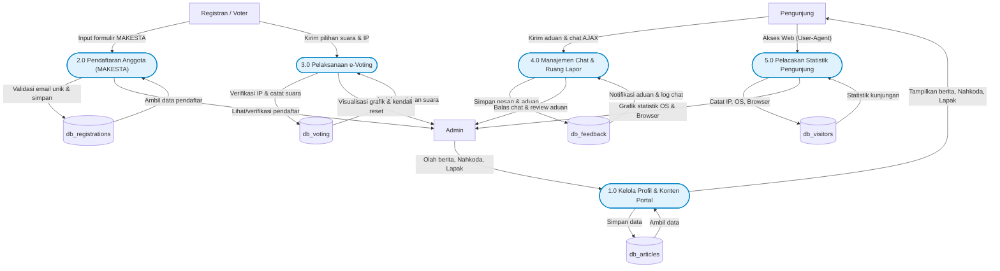

# ALUR DATA FLOW DIAGRAM (DFD) LEVEL 0

DFD Level 0 ini menggambarkan aliran data secara umum (Top-Level) dari Sistem Informasi Portal Web dan E-Voting PAC IPNU IPPNU Kecamatan Kemiri. Diagram ini menguraikan sistem tunggal menjadi 5 sub-proses transaksional utama yang berinteraksi secara dinamis dengan 3 entitas luar (Pengunjung, Registran/Voter, Admin) serta penyimpanan basis data (*Data Store* SQLite).

