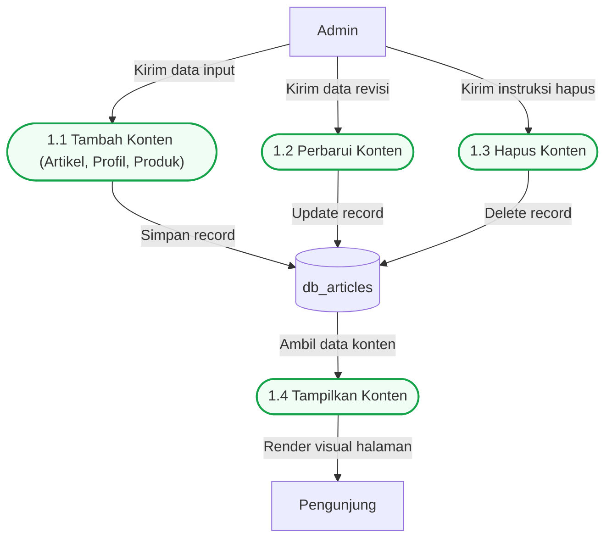
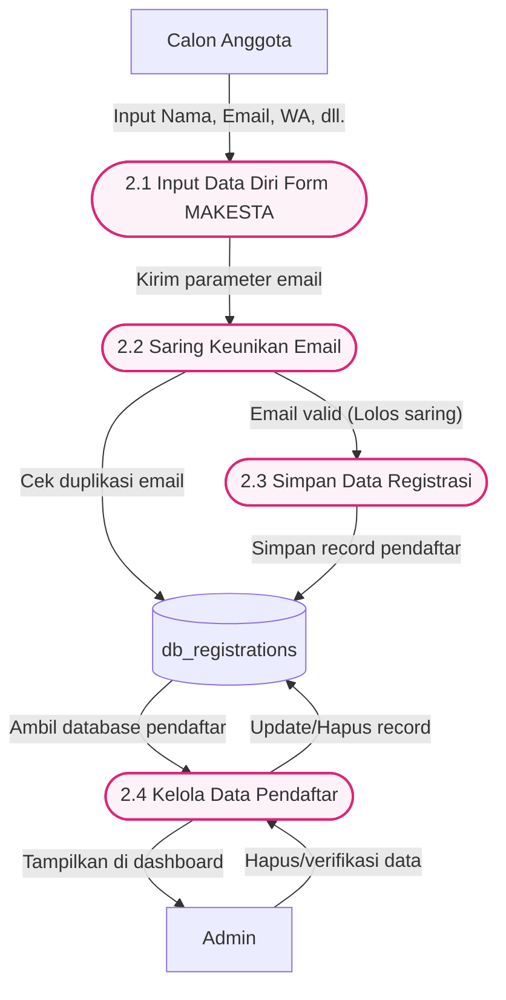
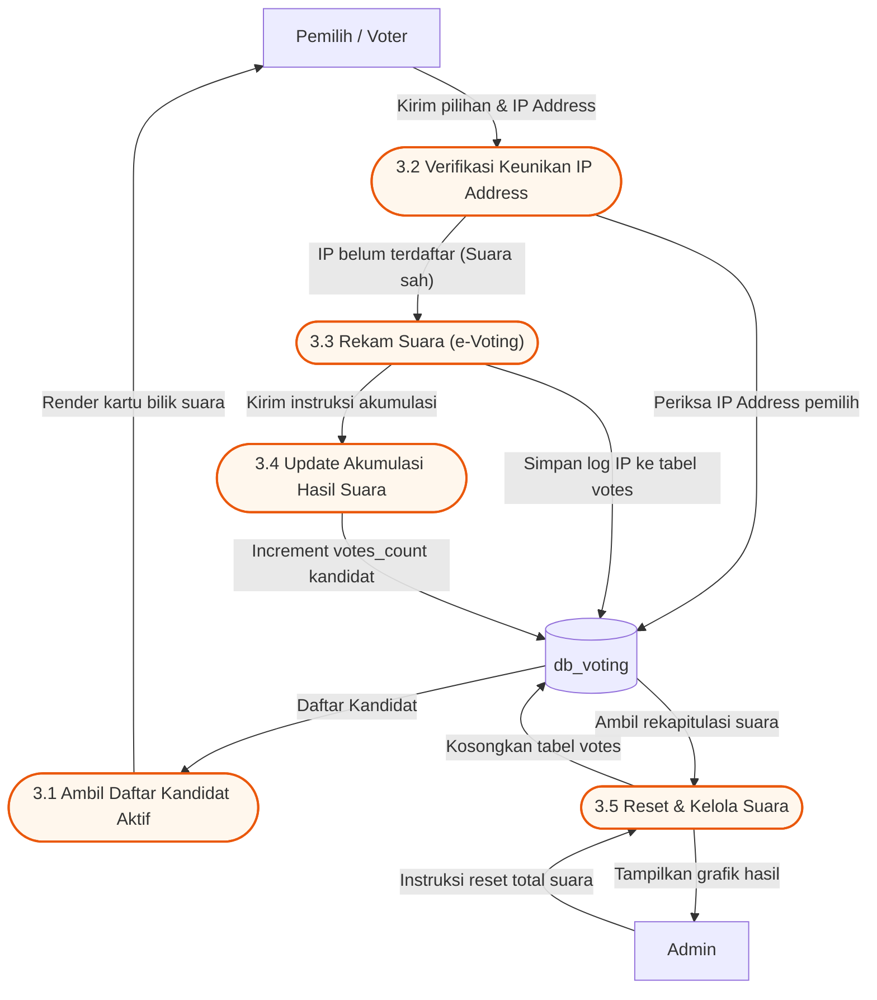
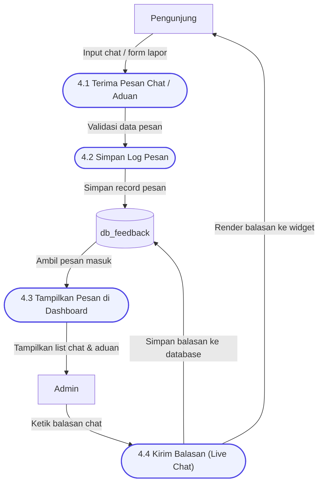
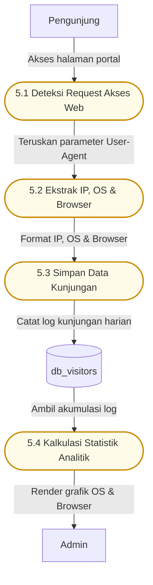

# ALUR DATA FLOW DIAGRAM (DFD) LEVEL 1

Berdasarkan DFD Level 0 Sistem Informasi Portal Web dan E-Voting PAC IPNU IPPNU Kecamatan Kemiri, berikut adalah penjabaran detail Data Flow Diagram (DFD) Level 1 untuk masing-masing proses utama.

---

## 1. DFD Level 1 - Proses 1.0 (Kelola Profil & Konten Portal)

Proses ini menguraikan bagaimana Administrator mengelola konten web, seperti artikel berita, profil pengurus (Nahkoda/BPH), dan katalog produk UMKM, serta bagaimana Pengunjung melihat konten tersebut.

---

## 2. DFD Level 1 - Proses 2.0 (Pendaftaran Anggota MAKESTA)

Proses ini menjelaskan alur registrasi calon anggota baru secara online, termasuk sistem penyaringan (validasi) untuk memastikan tidak ada duplikasi email.

---

## 3. DFD Level 1 - Proses 3.0 (Pelaksanaan e-Voting Terproteksi IP)

Proses ini menerangkan alur bilik suara digital, di mana sistem memvalidasi hak pilih berdasarkan *IP Address* perangkat agar tidak terjadi kecurangan atau pemungutan suara ganda.

---

## 4. DFD Level 1 - Proses 4.0 (Manajemen Chat & Ruang Lapor)

Proses ini menangani komunikasi interaktif dua arah antara pengunjung dengan sistem, baik melalui widget Live Chat (Chatbot) maupun form pengaduan (Ruang Lapor).

---

## 5. DFD Level 1 - Proses 5.0 (Pelacakan Statistik Pengunjung)

Proses ini memantau rekam jejak otomatis setiap *visitor* yang membuka situs, mencatat sistem operasi, browser, dan melengkapi data analitik untuk Admin.

