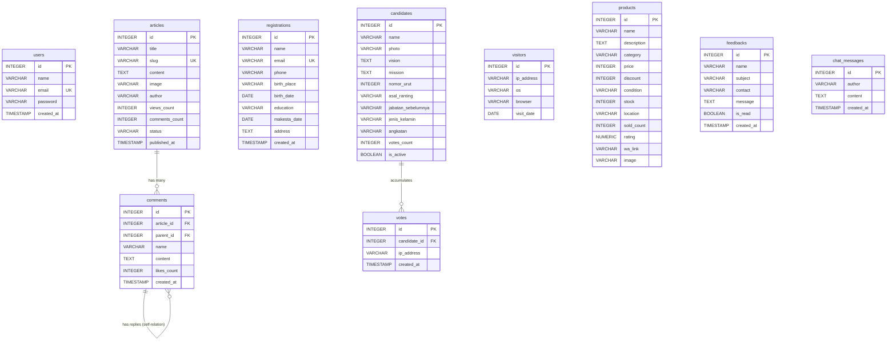

# ENTITY RELATIONSHIP DIAGRAM (ERD)

ERD memodelkan relasi konseptual antarentitas di dalam database SQLite Sistem Informasi Portal Web dan E-Voting PAC IPNU IPPNU Kemiri:

### Penjelasan Detil Entitas ERD:
* **`users`**: Menyimpan kredensial otentikasi login administrator.
* **`articles` & `comments`**: Menyimpan data berita kegiatan organisasi serta komentar bersarang (*nested comments*) dari pembaca.
* **`registrations`**: Menyimpan data formulir pendaftaran daring calon anggota baru MAKESTA.
* **`candidates` & `votes`**: Menyimpan profil lengkap calon ketua PAC, status keaktifan bilik suara, total akumulasi perolehan suara, serta log unik IP Address pemilih.
* **`visitors`**: Menyimpan log harian parameter IP Address, tipe sistem operasi, dan browser pengunjung portal.
* **`products`**: Menyimpan katalog lengkap produk Lapak Usaha UMKM milik kader.
* **`feedbacks` & `chat_messages`**: Menampung kiriman saran/kritik Ruang Lapor serta log obrolan chatbot.
