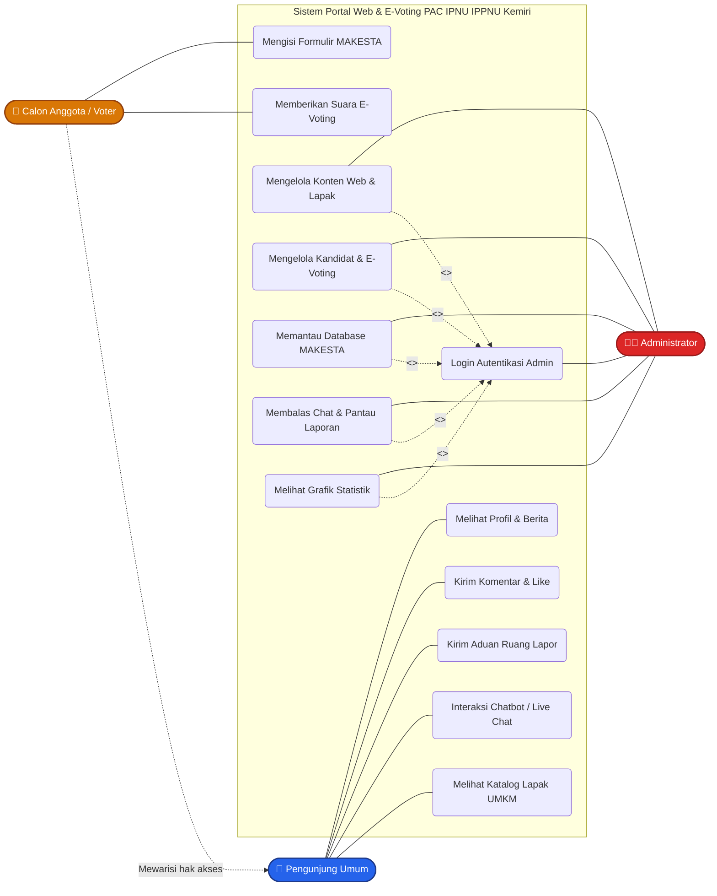

# ALUR USE CASE DIAGRAM

Berdasarkan analisis fungsionalitas Sistem Informasi Portal Web dan E-Voting PAC IPNU IPPNU Kecamatan Kemiri, berikut adalah pemodelan Use Case Diagram beserta skenario alurnya.

## 1. Visualisasi Use Case Diagram

Sistem ini melibatkan 3 (tiga) aktor utama: **Pengunjung Umum**, **Calon Anggota / Voter**, dan **Administrator**.

---

## 2. Definisi Aktor (Actors Definition)

| Aktor | Deskripsi Peran |
|---|---|
| **Pengunjung Umum** | Masyarakat atau anggota pasif yang mengakses portal web untuk mencari informasi kegiatan, melihat lapak kader, serta berinteraksi melalui chat/ruang lapor. |
| **Calon Anggota / Voter** | Pengunjung khusus yang memiliki kepentingan langsung untuk mendaftar sebagai kader baru (MAKESTA) atau anggota aktif yang menggunakan hak pilihnya di bilik suara E-Voting. |
| **Administrator** | Pengurus harian inti (Admin) yang memiliki akses penuh ke halaman *dashboard backend* untuk mengendalikan seluruh konten web, melihat rekapitulasi data pendaftar dan hasil *voting*. |

---

## 3. Skenario Alur Use Case (Use Case Scenarios)

### A. Alur Use Case Pengunjung Umum
1. **Melihat Profil & Berita:** Pengunjung membuka halaman depan, menavigasi menu profil (Sejarah, Visi-Misi, Struktur BPH), membaca artikel, dan melihat daftar produk Lapak UMKM.
2. **Kirim Komentar & Like:** Pengunjung yang sedang membaca artikel dapat meninggalkan jejak di kolom komentar dan menyukai (*like*) balasan pengunjung lain tanpa harus membuat akun (publik).
3. **Kirim Aduan Ruang Lapor:** Pengunjung mengisi *form* aduan atau saran yang akan langsung masuk secara privat ke panel admin.
4. **Interaksi Chatbot:** Pengunjung menggunakan *widget chatbot* di pojok kanan bawah untuk bertanya secara instan (*real-time AJAX*).

### B. Alur Use Case Calon Anggota / Voter
1. **Mengisi Formulir MAKESTA:** Calon anggota mengakses menu Pendaftaran, lalu mengisi data diri lengkap (Nama, Email, WA, Tempat Tanggal Lahir). Sistem akan otomatis melakukan validasi untuk memastikan email belum pernah dipakai (*unique filtering*).
2. **Memberikan Suara E-Voting:** Voter membuka halaman Bilik Suara, melihat daftar profil kandidat ketua, lalu menyalurkan suaranya. Sistem akan mencatat perolehan suara sekaligus menyimpan *IP Address* perangkat voter untuk memblokir pemungutan suara ganda (*double voting*).

### C. Alur Use Case Administrator
1. **Login Autentikasi (`<<include>>`):** Ini adalah *use case* wajib. Admin harus memasukkan kredensial aman (contoh: sandi `KEMIRI-HEBAT-2026`) untuk masuk ke *Dashboard*. Semua akses *use case* admin di bawahnya wajib menyertakan (*include*) proses *login* ini.
2. **Mengelola Konten Web & Lapak:** Menambah, mengubah, atau menghapus artikel berita, data pengurus BPH, serta memperbarui katalog harga/diskon di Lapak UMKM.
3. **Mengelola Kandidat & E-Voting:** Admin menambahkan profil kandidat ketua, mengubah status aktif kandidat, memantau *progress* jumlah suara masuk, dan menekan tombol *Reset* Suara bila terjadi pemilihan ulang.
4. **Memantau Database MAKESTA:** Admin membuka panel tabel data calon anggota baru yang telah lolos sistem penyaringan email, kemudian mencetak atau menghapus datanya.
5. **Membalas Chat & Pantau Laporan:** Admin membuka Ruang Chat *Backend* untuk membalas langsung pertanyaan pengunjung (*live chat*) dan memeriksa pesan yang masuk di Ruang Lapor.
6. **Melihat Grafik Statistik:** Admin memeriksa diagram OS dan *Browser* yang terdeteksi otomatis dari pelacakan perangkat pengunjung web setiap harinya.
